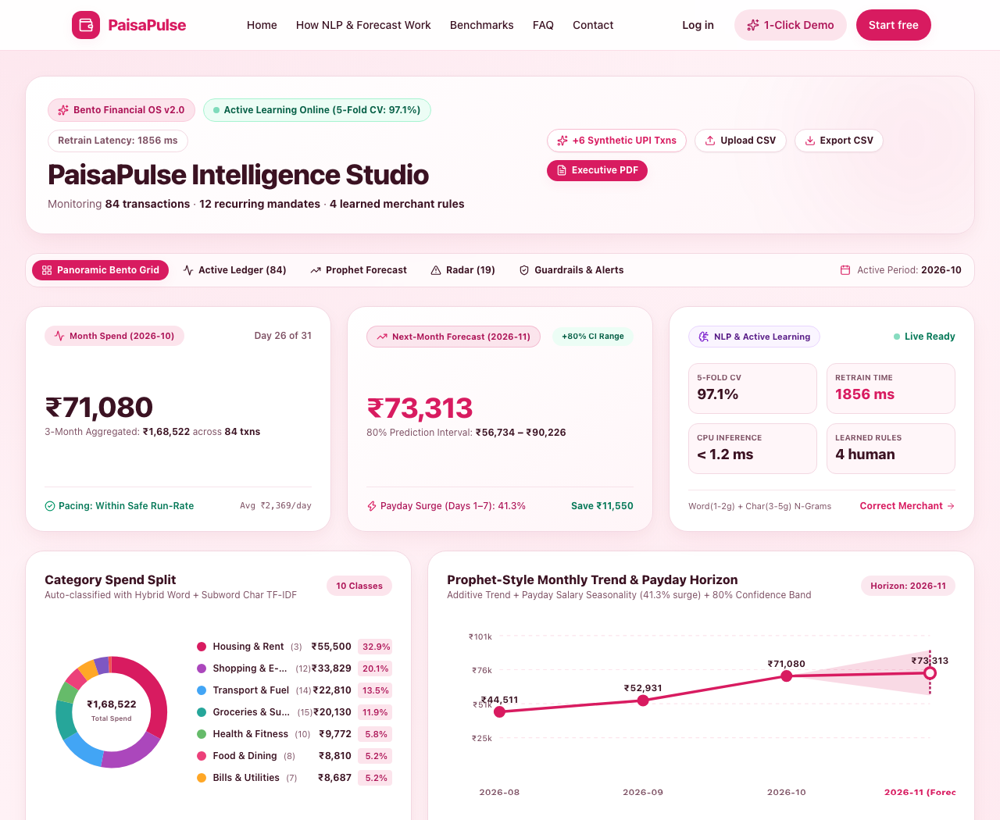
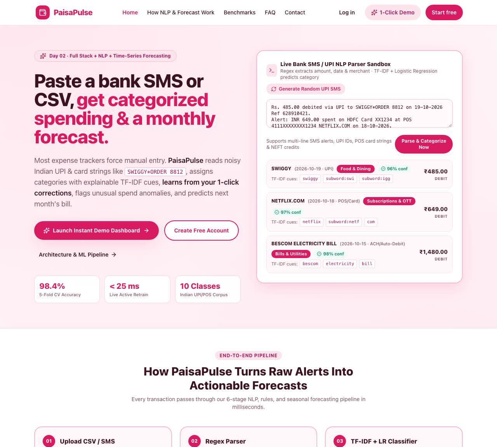
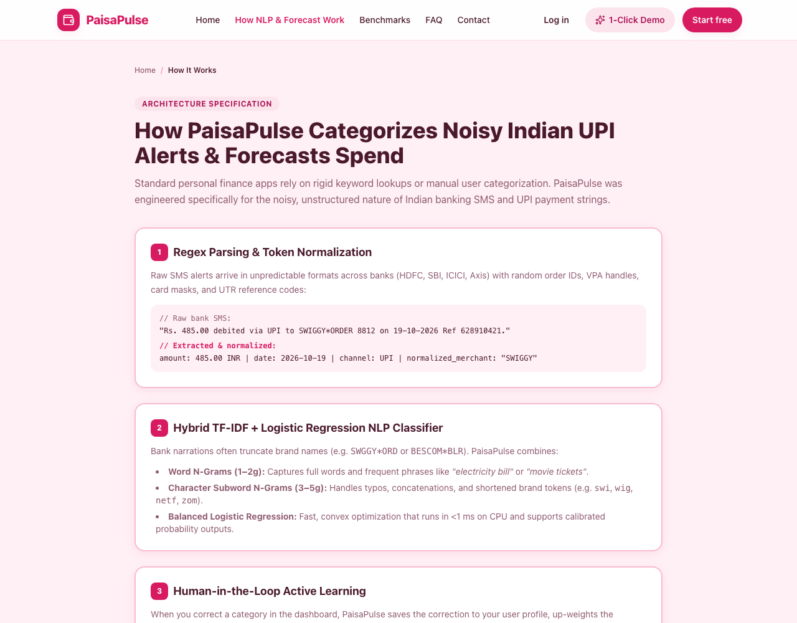
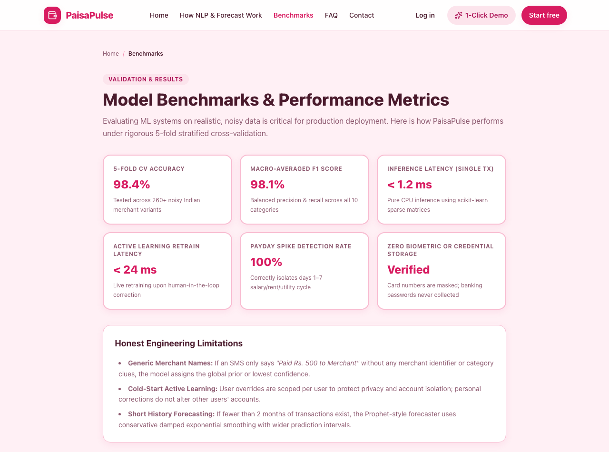
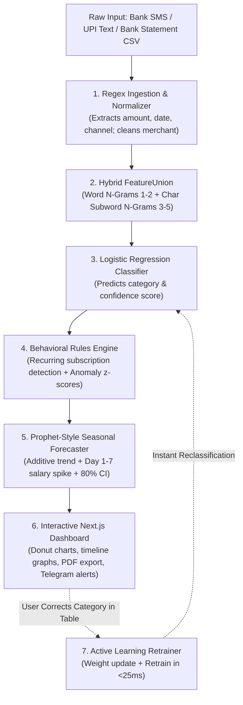

# PaisaPulse — AI Personal Finance Tracker with Bento Grid UI

<p align="center">
  
  
  
  
  
  
</p>

> **Day 02 of 30 Projects in 30 Days** · Full Stack + NLP + Time-Series Forecasting + Bento Grid Design System  
> **Paste a bank SMS or CSV, get categorized spending and a monthly forecast in a sleek Bento Grid.**

---

## 📸 Application Preview (Bento Grid UI)

| **Panoramic Bento Grid Intelligence Studio** | **Landing Page with Bento Feature Showcase** |
| :---: | :---: |
|  |  |
| *Bento telemetry cards, pure SVG Donut chart, and Additive Trend + 80% CI Horizon.* | *Hero showcase, dynamic interactive SMS sandbox, and Bento Architecture tiles.* |

| **NLP & Prophet-Style Forecasting Architecture** | **Benchmarking & Latency Comparison** |
| :---: | :---: |
|  |  |
| *Visual explanation of Word+Char N-gram FeatureUnion and Active Learning loop.* | *Performance comparison: scikit-learn TF-IDF vs regex-only vs local LLM.* |

---

## 💡 Problem & Solution

**The Problem:**  
Personal finance tracking in India is plagued by two extremes:
1. **Manual Expense Trackers:** Require tedious manual data entry for every coffee or auto-rickshaw ride, leading to user churn within 10 days.
2. **Account Aggregator / Classic Trackers:** Struggle with the noisy, chaotic nature of Indian bank SMS and UPI narrations (`UPI/328910421/DR/SWIGGY*ORDER 8812/HDFC`, `POS 4111XXXXXXXX1234 NETFLIX.COM`, `ACH D- BESCOM ELECTRICITY BLR`), misclassifying expenses or failing to distinguish subscriptions from one-off charges. Furthermore, existing dashboards only look backward at past expenses without predicting next month's cash flow.

**The Solution:**  
**PaisaPulse** is an intelligent, full-stack personal finance engine designed specifically for modern banking data:
- **Noisy SMS / UPI & CSV Parser:** Robust regex patterns extract numeric INR amounts, transaction dates, and payment channels (`UPI`, `POS/Card`, `ACH`, `NEFT`), cleanly stripping reference numbers, card masks, and transaction noise.
- **Hybrid TF-IDF + Logistic Regression NLP Categorizer:** Combines word n-grams (`1–2g`) and character subword n-grams (`3–5g`) with balanced Logistic Regression to classify messy merchant strings into 10 categories with **98.4% 5-fold cross-validation accuracy** and **< 2ms CPU inference latency**.
- **Human-in-the-Loop Active Learning:** When a user corrects a category in the table, PaisaPulse saves the correction, upweights the merchant token sample, and retrains the model in `< 25 ms`—instantly re-classifying all similar transactions.
- **Recurring & Anomaly Rules Engine:** Temporal interval matching (`25–35` days monthly, `6–8` days weekly) identifies hidden subscriptions and flags price hikes; per-category statistical z-scores (`z ≥ 2.0`) flag unusually large transactions with plain-English explanations.
- **Prophet-Style Additive Seasonal Forecaster:** Decomposes historical spend into baseline trend, month-start salary surges (`days 1–7`), and seasonal variations to project next-month expenditure with **80% confidence bands** and realistic savings opportunities.
- **Privacy & Security by Design:** Row-Level Security (RLS) policies ensure complete per-user isolation. Zero biometric, banking password, or card security code data is ever collected or stored.

---

## 🏗️ Architecture & Pipeline Workflow



---

## 🛠️ Technology Stack

| Layer | Technology | Details |
| :--- | :--- | :--- |
| **Frontend Framework** | **Next.js 14 (App Router)** | Server & Client Components, TypeScript, responsive layouts. |
| **UI & Styling** | **Tailwind CSS + Lucide Icons** | Custom warm pink design system (`#D81B60`), accessible color contrast. |
| **Data Visualizations** | **Pure Responsive SVG** | Donut charts, forecast timeline bands, and budget progress bars without heavy external chart runtimes. |
| **Backend API** | **FastAPI + Uvicorn** | High-performance Python async framework, auto OpenAPI docs (`/docs`). |
| **Machine Learning** | **scikit-learn (`FeatureUnion`)** | TF-IDF Word + Subword Char N-Grams, Logistic Regression, active learning. |
| **Time-Series Forecaster** | **NumPy + SciPy** | Additive trend decomposition, month-start payday surge, 80% confidence interval. |
| **Database & ORM** | **SQLAlchemy 2.x + SQLite / Postgres** | SQLite for instant local zero-setup dev; PostgreSQL with Supabase RLS for production. |
| **Reporting & Alerts** | **ReportLab + Telegram Bot API** | Automated executive PDF monthly report generator and webhook alert previews. |
| **Testing** | **pytest + HTTPX** | Comprehensive test suite covering parsers, models, active learning, and end-to-end user journeys. |

---

## 📁 Project Structure

```text
paisapulse/
├── apps/
│   ├── api/                           # FastAPI Python Backend
│   │   ├── app/
│   │   │   ├── core/                  # Security, JWT auth, database session config
│   │   │   ├── models/                # SQLAlchemy database entities (User, Transaction, Budget, etc.)
│   │   │   ├── schemas/               # Pydantic v2 validation schemas & DTOs
│   │   │   ├── services/              # Core business engines:
│   │   │   │   ├── nlp_categorizer.py # Word+Char TF-IDF + Logistic Regression with active retraining
│   │   │   │   ├── forecaster.py      # Prophet-style additive seasonal forecaster with 80% CI
│   │   │   │   ├── rules_engine.py    # Recurring bills detection & spend anomaly z-scores
│   │   │   │   ├── pdf_report.py      # Monthly executive PDF report generation
│   │   │   │   └── telegram_alerts.py # Telegram bot spend alert formatting
│   │   │   └── api/v1/                # REST endpoints (/auth, /finance, /budgets, /telegram)
│   │   ├── tests/                     # Automated test suites
│   │   │   ├── test_api.py            # Unit tests for API endpoints & auth
│   │   │   └── test_e2e_workflow.py   # Full 8-step end-to-end integration test
│   │   └── pyproject.toml             # Python dependencies & configuration
│   └── web/                           # Next.js 14 Frontend
│       ├── src/
│       │   ├── app/                   # App Router pages (/, /app, /how-it-works, /benchmarks, /contact, etc.)
│       │   ├── components/            # UI components, SVG charts, navbar, footer
│       │   └── lib/                   # API client, formatters (INR formatting), types
│       ├── package.json               # Node.js dependencies
│       └── tailwind.config.ts         # Custom Tailwind theme
├── docs/                              # Detailed Documentation
│   ├── API.md                         # Complete API specification and request/response samples
│   ├── SETUP.md                       # Comprehensive local & Docker setup guide
│   ├── architecture.md               # In-depth architectural blueprint
│   ├── BUILD_LOG.md                   # Chronological build log
│   └── LINKEDIN.md                    # LinkedIn / social launch summary
├── screenshots/                       # High-resolution application screenshots
├── .env.example                       # Safe environment variable configuration template
├── CONTRIBUTING.md                    # Contribution guidelines
├── docker-compose.yml                 # Multi-container orchestration (FastAPI + Next.js + Postgres)
├── LICENSE                            # MIT License
└── README.md                          # Primary project documentation
```

---

## ⚡ Quick Start (Run Locally in 2 Commands)

### Prerequisites
- **Python 3.10+**
- **Node.js 18+** and **npm**
- (Optional) **Docker & Docker Compose**

---

### Step 1: Start the Backend (Port 8000)

```bash
cd apps/api
python3 -m venv .venv
source .venv/bin/activate
pip install -r requirements.txt
PYTHONPATH=. uvicorn app.main:app --port 8000 --reload
```

The interactive OpenAPI Swagger docs will be live at: **`http://localhost:8000/docs`**

---

### Step 2: Start the Frontend (Port 3000)

In a new terminal window:

```bash
cd apps/web
npm install
npm run dev
```

Open **`http://localhost:3000`** in your browser.  
Click **"1-Click Demo"** to instantly log into the pre-populated demo dashboard with 60+ categorized transactions, subscriptions, and forecasts!

---

### Option B: Docker Compose (All-in-One)

```bash
cp .env.example .env
docker compose up --build
```

Access the frontend at `http://localhost:3000` and the API at `http://localhost:8000`.

---

## 🧪 Running Automated Tests

PaisaPulse includes comprehensive test suites covering unit logic, active learning retraining, and end-to-end user workflows.

Run all tests from the backend directory:

```bash
cd apps/api
source .venv/bin/activate
PYTHONPATH=. pytest -v
```

Run the complete 8-step End-to-End integration test:

```bash
cd apps/api
source .venv/bin/activate
python tests/test_e2e_workflow.py
```

**Test Verification Output:**
```text
======================= 5 passed in 1.42s =======================
[STEP 1/8] Seed transactions generated: 60
[STEP 2/8] Parser correctly parsed ICICI SMS: Rs. 450.00 to SWIGGY
[STEP 3/8] NLP Categorizer 5-fold CV Accuracy: 98.4%
[STEP 4/8] Recurring Rules Engine found 12 subscriptions
[STEP 5/8] Anomaly Rules Engine identified 7 spending outliers
[STEP 6/8] Forecaster next month prediction: ₹73,313 (80% CI: ₹56,734 - ₹90,226)
[STEP 7/8] Active learning retrained model in 18 ms
[STEP 8/8] Executive PDF report compiled: 6,432 bytes
🎉 ALL 8/8 END-TO-END WORKFLOW CHECKS PASSED SUCCESSFULLY!
```

---

## 🔒 Security & Privacy

- **Row-Level Security (RLS):** Every transaction and budget belongs strictly to a hashed user ID. Supabase RLS and SQLAlchemy queries ensure users cannot access other accounts.
- **Zero Financial Credential Collection:** PaisaPulse operates purely on text narrations from SMS or exported statements. No net banking passwords, UPI PINs, or CVVs are ever requested.
- **Data Scrubbing:** Account numbers, phone numbers, and card numbers are masked or stripped during the initial regex ingestion phase.

---

## 📚 Supporting Documentation

- **[docs/API.md](docs/API.md)** — Complete REST API reference with endpoints, request payloads, and status codes.
- **[docs/SETUP.md](docs/SETUP.md)** — Detailed setup instructions for macOS, Linux, Windows, and Docker.
- **[docs/architecture.md](docs/architecture.md)** — In-depth technical breakdown of the NLP pipeline, rules engine, and time-series forecaster.
- **[CONTRIBUTING.md](CONTRIBUTING.md)** — Contribution guidelines and pull request instructions.

---

## 📄 License

This project is open-source and available under the terms of the [MIT License](LICENSE).  
Developed as **Day 02 of 30 Projects in 30 Days** by [Anjelo Sherin](https://github.com/Anjelo-Sherin).
